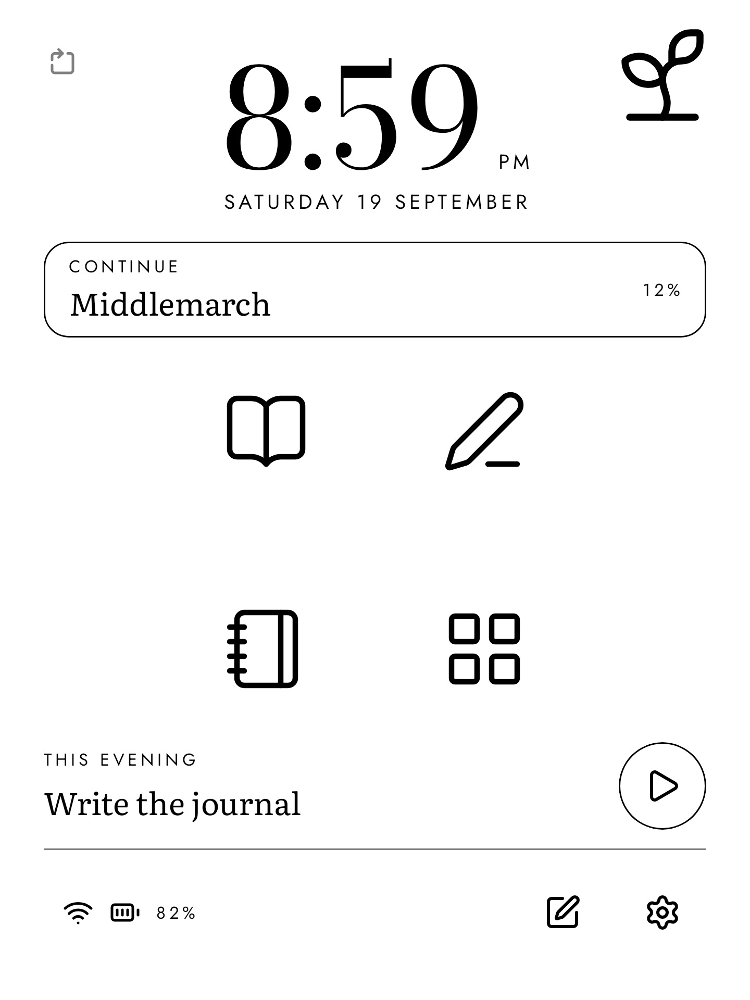
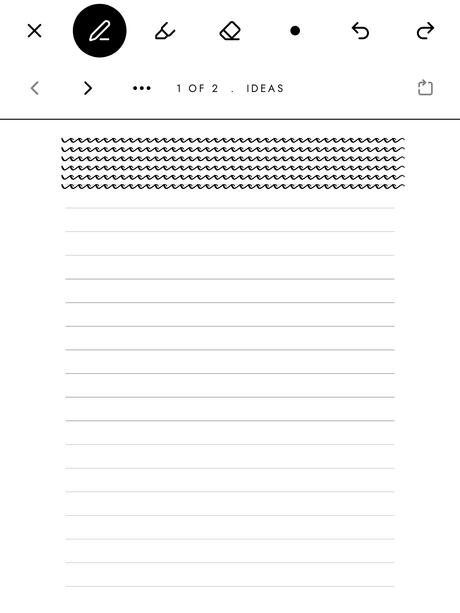
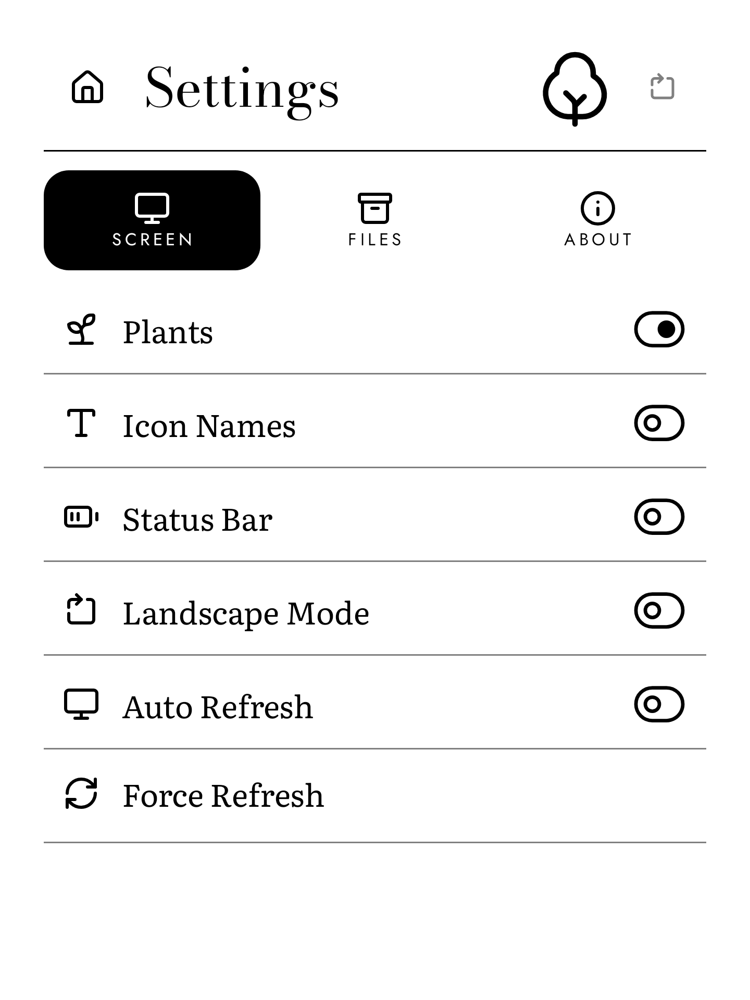
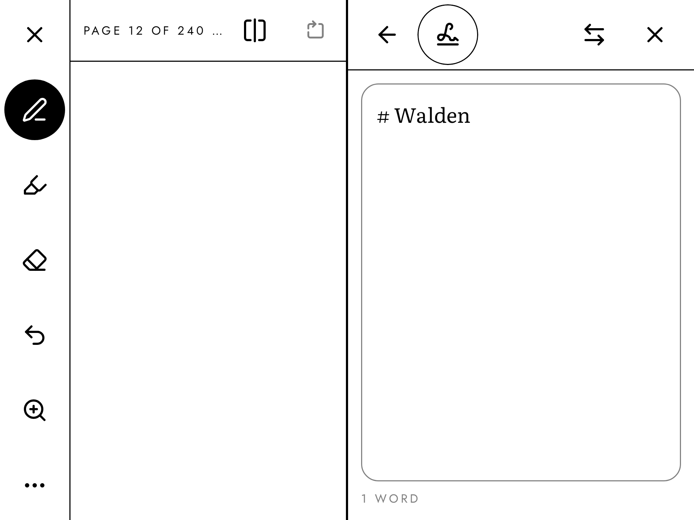

# Margin

[](https://github.com/FoxesRCool1/Margin-Eink-Launcher/releases/latest)
[](LICENSE)
[](https://github.com/FoxesRCool1/Margin-Eink-Launcher/actions/workflows/ci.yml)

**A calm home screen for e-ink Android tablets. Read, write and keep a journal.**

Margin is a free, open source launcher. It has no animations, no scrolling
and no clutter. Everything is black on white. It needs Android 10 or newer.

The idea comes from Micah Daigle's "Prose": a distraction-free e-ink device
for reading and writing.

**[Download the free APK](https://github.com/FoxesRCool1/Margin-Eink-Launcher/releases/latest)**
· [How to install](#install)

| Home | Reading | Handwriting |
| --- | --- | --- |
|  |  |  |

| Journal | Settings | A book and a note, side by side |
| --- | --- | --- |
|  |  |  |

The pictures come from the screenshot tests. The book is *Walden* by Henry
David Thoreau (1854), which is in the public domain.

## What it does

- **Home.** A big clock, a Continue row for your last book or note, and the
  routine item for this part of the day. One tap starts a typed note or a
  blank page to write on by hand.
- **Read.** EPUB and PDF books, one page at a time. Highlights, notes and
  pen marks.
- **Write.** Typed notes in Markdown and handwritten notebooks. The pen
  line is smooth and follows the pressure. Export to PDF and PNG.
- **Journal.** One entry a day, with a month view, habits and a daily word
  goal.
- **Apps.** Pinned apps, your own folders, and all apps from A to Z.
- **Split screen.** Open a note beside a book, or any page beside another.
- **Made for e-ink.** Pages instead of scrolling. A button turns black at
  once when pressed. As little of the screen changes as possible.

## Install

Margin is not on Google Play. You install it from an APK file.

1. On the tablet, open the
   [latest release](https://github.com/FoxesRCool1/Margin-Eink-Launcher/releases/latest)
   in the browser.
2. Download the file for your tablet. On a ViWoods tablet, take the file
   that ends in `-viwoods.apk`. On any other tablet, take `-generic.apk`.
3. Open the file. Allow the browser to install apps, then press Install.
4. Open Margin. Go to Settings, Screen, "Set as Home App", and choose
   Margin. (Some ViWoods firmware hides this choice. Margin then shows
   other steps.)

You cannot get stuck. The first page of Apps always shows the stock launcher
and the settings apps. To go back, make the stock launcher the home app
again, or uninstall Margin.

To update, go to Settings, About, Updates. Your books, notes and settings
stay. Test versions from before 1.0.0 cannot update. Back up first
(Settings, Files, Back Up), install 1.0.0, then restore. After an update Android may show the stock
launcher once. Press the Home key.

On ViWoods, Settings, Pen also has Fast 1 and Fast 2. They use hidden calls
that are not proven on every firmware. Try them with "Try the Pen" first.

## Which tablets

Margin is tested on the ViWoods AiPaper Mini (Android 13) and in an Android
emulator. Other e-ink tablets, such as Boox, are not tested yet. If you try
Margin on one, please open an issue and say how it went.

## Your files

Every note, highlight and journal entry is a plain file in one folder:
`Android/data/io.github.foxesrcool1.margin/files/Margin/`. Typed notes are
Markdown. Handwritten notes are zip files with the strokes and a PNG of each
page.

**If you uninstall Margin, Android deletes this folder.** Back up first:
Settings, Files, Back Up. It saves everything in one zip file.

## Privacy

No account, no tracking, no ads. The app goes online for one thing only:
when you press "Check for updates". A book cannot go online at all.

Every file on the releases page is signed with the release key of this
project. The key fingerprint is in [`docs/RELEASING.md`](docs/RELEASING.md).

## Build from source

You need JDK 17 or newer and the Android SDK with platform 37.

```
./gradlew assembleViwoodsDebug      # for a ViWoods tablet
./gradlew assembleGenericDebug      # for any other Android device
./gradlew testViwoodsDebugUnitTest  # unit tests and screenshots
```

See [`CONTRIBUTING.md`](CONTRIBUTING.md) for more.

## Help and contributing

Open an [issue](https://github.com/FoxesRCool1/Margin-Eink-Launcher/issues).
Attach the log: Settings, About, Log, then the download icon. The files go to
`Download/Margin`.

Changes are welcome. [`CONTRIBUTING.md`](CONTRIBUTING.md) says how to send
one.

## Support the project

The app is free, and it stays free. If you want to help pay for the work,
there is a Ko-fi page: https://ko-fi.com/foxesrcool. The app never asks. The
same link is in Settings, About, "Support This App".

## Credits

- Idea: ["Prose: The distraction-free, e-ink laptop that should
  exist"](https://medium.com/this-should-exist/prose-a-distraction-free-e-ink-laptop-for-thinkers-writers-4182a62d63b2)
  by Micah Daigle. No image or layout from it is used here.
- ViWoods calls: reference only, from
  [`jdkruzr/ViwoodsAppDev`](https://github.com/jdkruzr/ViwoodsAppDev). No
  code from it is in this project.
- [Readium Kotlin Toolkit](https://github.com/readium/kotlin-toolkit) reads
  EPUB books (BSD 3-Clause).
- Fonts: Bodoni Moda, Jost and Literata (SIL OFL 1.1). Icons:
  [Lucide](https://lucide.dev) (ISC), some from Feather (MIT).

[`ASSETS.md`](ASSETS.md) lists every font and drawing.
[`licenses/DEPENDENCIES.md`](licenses/DEPENDENCIES.md) lists every library.

## Licence

Apache-2.0. See [`LICENSE`](LICENSE). Free to use, change and share.
